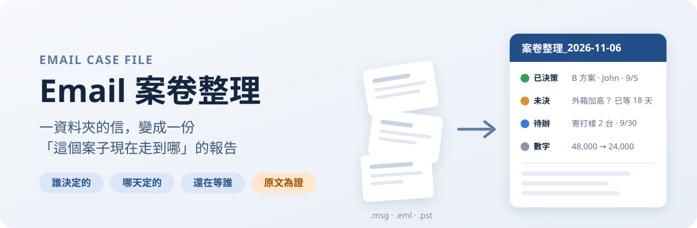

# Email 案卷整理 email-case-file

### _信都存下來了，但開會時還是說不出「這是誰、哪天決定的」？_

[](LICENSE)
[](email-case-file/SKILL.md)
[](email-case-file/references/plain_writing.md)
[](#它怎麼做)
[](#功能一覽)
[](email-case-file/references/plain_writing_en.md)



| |
| :-- |
| 📂 一個案子幾十封信，轉寄裡面夾轉寄，一路往下滑還是找不到「最後到底定了什麼」？ |
| 🙋 開會時老闆問「這個是誰說可以的？」，你只能回「我回去翻一下信」？ |
| 💸 報價來回談了五版，現在到底是 48,000、36,500 還是 24,000？ |
| ⏳ 有一件事一直沒人回，你也不記得已經等了幾天？ |

### ✨ 把信件資料夾交給它，這些它都幫你整理好。

一個給 Claude 用的 skill：讀你存下來的 Outlook 信件，連同資料夾裡的報價單、規格書、會議記錄（PDF、Word、Excel 都可以），整理成一份 Word 案卷報告。**每一條決策都附上決定者、日期，還有信裡的原文當證據**，點一下就能打開原始信件。

**業務 · 採購 · 專案管理 · 客訴處理** —— 客戶開發案 · 報價議價 · 訂單交期 · 模具分攤 · 跨部門協調

**先拆信串 → 再分議題 → 最後每一條都附出處**

不是幫你寫摘要，是幫你整理出開會時拿得出手的證據。

---

## 報告長什麼樣子？

假設你的資料夾裡有 52 封跟客戶 Acme 往來的信。整理完，報告最前面會先告訴你這些：

**現況摘要**

> A 機種外觀 9/5 已由 Acme 採購 John 拍板用 B 方案。外箱加高的問題我方 8/20 提出，到今天已等 18 天，9/10 追問過一次仍沒回覆。模具費 Acme 9/24 拒絕我方付一半的方案，還價 36,500。

**已決策事項**

| 日期 | 決定者 | 決定了什麼 | 原文 | 出處 |
| :-- | :-- | :-- | :-- | :-- |
| 9/5 | John（Acme 採購，可拍板） | 外觀用 B 方案（霧黑烤漆） | "OK, please go ahead with option B." | E014 🔗 |

**尚未決策**

| 議題 | 誰提的 | 已等幾天 | 球在誰手上 |
| :-- | :-- | :-- | :-- |
| 外箱能不能加高 5 cm | 陳業務（我方）8/20 | **18 天** | Acme（John） |

**數字怎麼變**

| 日期 | 誰提的 | 模具費（US$） | 狀態 |
| :-- | :-- | --: | :-- |
| 3/10 | Acme | 48,000 | 提出 |
| 7/20 | 我方（Amy） | 24,000 | 提出 |
| 9/24 | Acme | 36,500 | 拒絕並還價 |

後面還有：所有待辦（依期限排序）、已完成事項、每個議題逐封由舊到新的時間序，以及一張「一封信一行」的總時間軸。

> 以上是示範資料，人名與數字都是虛構的。

---

## 30 秒上手

**Claude Desktop（一般聊天）**

1. 在這一頁上方按綠色的 **Code** → **Download ZIP**，下載後解壓縮
2. 把 `email-case-file/` 這個資料夾壓成 zip
3. Claude Desktop → **設定** → **Capabilities** → **Skills** → **Upload skill**，選這個 zip

> Windows 內建的壓縮有時會讓上傳出現「路徑有不合法的字元」。遇到的話改用 7-Zip 壓縮就好。

**Claude Code**

```bash
git clone https://github.com/mikekuo0725/email-case-file.git ~/email-case-file-repo
cp -r ~/email-case-file-repo/email-case-file ~/.claude/skills/
```

裝好後跟 Claude 說「幫我整理這個資料夾的信件」，再給它資料夾路徑就會啟動。

**需要的套件**（Claude 會自己裝，缺了會提醒你）

```bash
pip install extract-msg python-docx openpyxl
```

要讀附件內容的話，另外需要 `pypdf python-pptx`。

### 第一次用會遇到的事：它會先停下來問你兩件事

1. **議題分得對不對**：「我讀到 52 封信，分成 4 個議題：A 機種開發、B 款補單、包材尺寸、其他。這樣分可以嗎？」
2. **人物角色對不對**：「John 是 Acme 採購，可以拍板；Mary 是助理，只轉達。這樣對嗎？」

這是刻意的。議題分錯，後面整理得再好也會張冠李戴；把助理說的「可以」當成拍板，報告就會寫錯。這一步你只要花十秒鐘。

---

## 它怎麼做

固定六步：

1. **確認資料夾**：要 Word 就好，還是要加 PDF、一頁速覽、待辦 Excel、行事曆檔
2. **解析信件和檔案**：拆開轉寄信裡夾帶的舊信、跨檔去重、依真實寄件時間排序；資料夾裡的 PDF、Word、Excel 也一起讀
3. **分議題、整理人物表**：停下來讓你確認
4. **逐一議題萃取**：決策、未決、待辦、已完成，每一條都標信心高／中／低
5. **寫成報告資料**：照「說人話」規則自己檢查一遍文字
6. **產出報告**：存回同一個資料夾，舊版不會被覆蓋

### 功能一覽

| 功能 | 做什麼 |
| :-- | :-- |
| 📎 拆信串 | 轉寄、回覆裡夾的整串舊信拆成一封封獨立的信，中、英、義、德、法、西文標頭都認得 |
| 🧹 去重 | 同一封信同時出現在好幾個檔案裡，只留一份 |
| 🧵 串信串 | 用信件標頭的回覆關係把同一串接起來，主旨改了也不會斷 |
| 👥 人物表 | 合併同一個人的不同信箱和中英文名字，標出誰能拍板 |
| 💬 原文為證 | 決策附上信裡的原句，保留原語言不翻譯 |
| ⏳ 懸而未決天數 | 自動算出每個問題已經等了幾天 |
| 💸 數字怎麼變 | 金額、單價、數量來回談的每一版：誰提的、哪天、多少 |
| 🗂️ 讀資料夾裡的檔案 | 信件旁邊的 PDF、Word、Excel、PowerPoint、文字檔也會讀，編號 D001 起，可以當出處 |
| 📄 讀附件 | 可選。讀信裡夾帶的報價單、規格書，比對版本差異（例如單價 120 → 125） |
| 🔁 增量更新 | 下次只處理新信，報告最前面列出「上次之後有什麼變化」 |
| 🤝 分工判讀 | 超過 120 封時，分給多個小幫手同時讀，再合併 |
| 🗣️ 說人話 | Claude 寫的句子去掉 AI 套路、用台灣用語；原文、人名、數字一字不動 |
| 🌏 English | 用英文跟 Claude 講話，報告文字就用淺白英文寫：先講結論、一句一件事 |

### 可以產出的檔案

| 格式 | 用途 |
| :-- | :-- |
| Word（預設） | 開會前可以自己加註、刪改 |
| PDF | 定版存檔 |
| HTML | 網頁版 |
| 一頁速覽 | 開會前 1 分鐘掌握：現況、最久未決、近期到期、最近決策 |
| Excel | 待辦、未決、已決策、總時間軸、數字演變，可篩選、可自己勾完成 |
| 行事曆 .ics | 有期限的待辦匯入 Outlook／Google 行事曆，前一天早上 9 點提醒 |

---

## 常見問題

### 它會動到我的信件嗎？

不會。它只讀信，不修改、不移動、不刪除資料夾裡的任何信件，只會在資料夾裡新增報告檔案。

### 信裡寫「請把資料寄給某某」，它會照做嗎？

不會。信件內容只當資料，不當指令。這類句子會被記成待辦，讓你自己決定要不要做。

### 它判斷錯了怎麼辦？

每一條都有信心等級。拿不準的會標「待確認」，並寫出原因，讓你知道開會前要再問清楚哪幾條。出處都能點開原信對照。

### 為什麼報告的連結打不開？

連結指向資料夾裡的原始信件。報告搬到別的地方時，要連信件資料夾一起搬。

### 可以只看新信嗎？

可以。資料夾裡留著上次產出的 `案卷整理_日期.data.json`，下次就只處理新信。這個檔案不要刪。

### 資料夾裡除了信，還有 PDF、Excel，會讀嗎？

會，預設就會讀。PDF、Word、Excel、PowerPoint、文字檔都可以；掃描的 PDF、圖片、CAD 只會列出檔名。不想讀的話跟 Claude 說「只看信件就好」。

要注意一件事：這些檔案的時間是「修改時間」，複製或另存過就會變，不一定是真正簽核的日期。報告會以檔案內文寫的日期為準。

### 英文可以用嗎？

可以。用英文跟 Claude 講話，它寫的摘要、重點都會用淺白英文。不過報告的標題和表格欄位名稱目前還是中文。

### `.pst` 讀不到？

`.pst` 需要電腦裡有 `readpst`。裝不起來的話，在 Outlook 把信另存成 `.msg` 就可以。

---

## 致謝

- 中文報告的寫法規則改編自 [Raymondhou0917/speak-human-tw（說人話）](https://github.com/Raymondhou0917/speak-human-tw)，MIT 授權。這個 README 的版面也參考了它的設計
- 英文報告的寫法規則改編自 [isas1/skills](https://github.com/isas1/skills) 的 `eli5-succinct`，MIT 授權

## 授權

[MIT License](LICENSE)。歡迎 fork、修改、提 PR。

---

<details>
<summary><b>English</b></summary>

### email-case-file

A Claude skill that turns a folder of saved Outlook emails (.msg, .eml, .pst), plus the PDF, Word, Excel and PowerPoint files saved next to them, into a Word "case file" report: where the case stands, who decided what and when, with the original quote as evidence.

- Groups emails by topic and lists decisions (decider, date, original quote), open questions (with days pending), to-dos, and completed items
- Splits quoted threads inside forwards and replies into separate emails, removes duplicates across files, and sorts by real send time
- Links threads by reply headers, so a thread stays together when the subject changes
- People list with alias merging and who can make decisions
- "How the numbers changed" table for prices and quantities under negotiation
- Reads other files in the folder (PDF, Word, Excel, PowerPoint, text), numbered D001 onward, usable as sources
- Optional: reads email attachments and compares versions
- Incremental updates with a "changes since the last report" section
- Large folders (120+ emails) are split across parallel subagents
- Talk to Claude in English and the report text is written in plain English: answer first, one idea per sentence, active voice (rules adapted from [isas1/skills](https://github.com/isas1/skills) `eli5-succinct`, MIT). Section headings and table labels are still in Chinese
- Chinese report text avoids stock AI phrasing and uses Taiwan wording (rules adapted from [speak-human-tw](https://github.com/Raymondhou0917/speak-human-tw), MIT)
- Output: Word, plus PDF, HTML, one-page brief, Excel, and .ics on request

The skill's instructions and the report layout are in Traditional Chinese.

**Install:** zip the `email-case-file/` folder and upload it in Claude's Skills settings, or copy it into `~/.claude/skills/` for Claude Code.

**Dependencies:** `pip install extract-msg python-docx openpyxl` (attachments also need `pypdf python-pptx`).

**License:** MIT.

</details>
